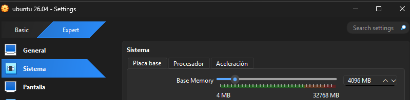
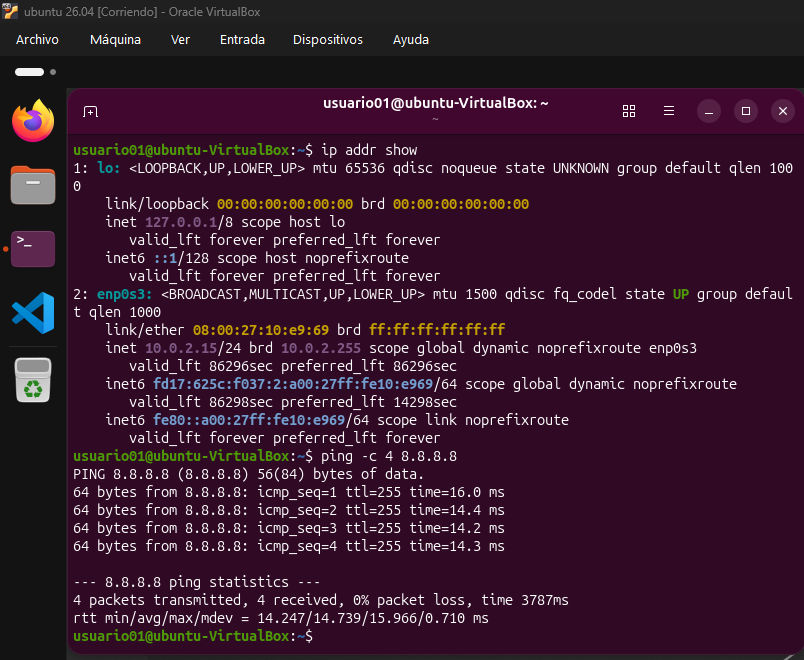

# Guía de Instalación de Ubuntu en una Máquina Virtual

Esta guía técnica explica paso a paso cómo instalar **Ubuntu** en una máquina virtual utilizando *VirtualBox*. Está dirigida a estudiantes, desarrolladores y cualquier persona que desee probar un sistema operativo GNU/Linux de forma segura y aislada en su equipo actual.

---

## Índice
* [1. Introducción](#1-introducción)
* [2. Requisitos previos](#2-requisitos-previos)
* [3. Procedimiento de instalación](#3-procedimiento-de-instalación)
  * [3.1 Creación de la máquina virtual](#31-creación-de-la-máquina-virtual)
  * [3.2 Configuración del almacenamiento y arranque](#32-configuración-del-almacenamiento-y-arranque)
  * [3.3 Instalación del sistema operativo](#33-instalación-del-sistema-operativo)
* [4. Comprobación y red](#4-comprobación-y-red)
* [5. Resolución de problemas comunes](#5-resolución-de-problemas-comunes)
* [6. Referencias](#6-referencias)

---

## 1. Introducción

Virtualizar sistemas operativos es una práctica fundamental en informática. Permite ejecutar un sistema completo (**invitado**) dentro de otro principal (**anfitrión**) sin alterar la partición física del disco duro principal. El objetivo de este manual es proporcionar un procedimiento limpio, rápido y guiado para desplegar Ubuntu con éxito.

> **Aviso importante:** Asegúrate de tener de suficiente espacio libre en disco y de tener activada la **virtualización por hardware ** en la BIOS/UEFI del ordenador antes de comenzar.

---

## 2. Requisitos previos

Antes de iniciar la creación de la máquina virtual, debes recopilar los siguientes elementos y recursos técnicos:

* Un ordenador anfitrión con al menos **8 GB de memoria RAM** (se asignarán 4 GB a la máquina virtual).
* Al menos **25 GB de espacio libre** en disco duro.
* El software de virtualización instalado, como [Oracle VM VirtualBox](https://www.virtualbox.org/).
* La imagen oficial en formato ISO de Ubuntu descargada desde su [sitio web oficial](https://ubuntu.com/download/desktop).

A continuación se muestra una tabla comparativa con los recursos recomendados según el uso que se le vaya a dar a la máquina virtual:

| Componente | Uso Básico | Uso Avanzado |
| :--- | :--- | :--- |
| **Memoria RAM** | 2 GB - 4 GB | 8 GB o superior |
| **Procesadores (Núcleos)** | 2 núcleos | 4 núcleos o más |
| **Disco Duro** | 25 GB  | 50 GB o superior |

---

## 3. Procedimiento de instalación

Sigue atentamente cada uno de los pasos descritos a continuación para configurar y poner en marcha tu entorno virtual con Ubuntu.

### 3.1 Creación de la máquina virtual

1. Abre **VirtualBox** en tu equipo anfitrión.
2. Haz clic en el botón **Nueva** (New) situada en la parte superior.
3. Rellena los datos básicos:
   * **Nombre:** `Ubuntu-VM`
   * **Carpeta de la máquina:** Selecciona la ruta donde deseas guardarla.
   * **Imagen ISO:** Selecciona el archivo `.iso` de Ubuntu que descargaste previamente.

4. Asigna los recursos de hardware recomendados (por ejemplo, **4096 MB** de RAM y **2** CPUs).



### 3.2 Configuración del almacenamiento y arranque

Una vez creada la estructura base, debemos asegurarnos de que el disco virtual tenga el tamaño adecuado y que el orden de arranque sea correcto:

1. Selecciona la máquina virtual creada y haz clic en **Configuración**.
2. Dirígete al apartado de **Almacenamiento**.
3. Comprueba que el archivo ISO aparezca correctamente montado en la unidad óptica virtual.

### 3.3 Instalación del sistema operativo

1. Inicia la máquina virtual haciendo clic en **Iniciar**.
2. En el menú de arranque de Ubuntu, selecciona *Try or Install Ubuntu*.
3. Sigue las instrucciones del instalador gráfico en pantalla: selecciona el idioma, la distribución del teclado y el tipo de instalación (*Instalación normal*).
4. Elige la opción de borrar disco e instalar Ubuntu.
5. Configurar y crear usuario y contraseña con el comando interno o el formulario gráfico.
6. Una vez finalizada la instalación de Ubuntu, es una buena práctica de seguridad y estabilidad actualizar el sistema operativo. Abre la terminal y ejecuta:

`sudo apt update && sudo apt upgrade -y`

Esto sincronizará los repositorios e instalará las últimas versiones de los paquetes disponibles.

> **Consejo de rendimiento:** Si la ventana de Ubuntu se ve muy pequeña y no se adapta al tamaño de tu monitor, dirígete al menú superior de VirtualBox, selecciona **Dispositivos > Insertar imagen de CD de las «Guest Additions»**. Esto instalará los controladores de vídeo necesarios para la pantalla completa.

---

## 4. Comprobación de red

Una vez finalizada la instalación y reiniciada la máquina virtual, es recomendable comprobar que la red y las interfaces funcionan correctamente.

Para verificar la conectividad y la dirección IP asignada al sistema invitado, abre una terminal dentro de Ubuntu (`Ctrl + Alt + T`) y ejecuta el siguiente comando:

```bash
# Comprobar las interfaces de red y la dirección IP actual
ip addr show
```

También puedes comprobar el estado de los servicios básicos de red ejecutando un *ping* rápido hacia el exterior:

```bash
ping -c 4 8.8.8.8
```

---

## 5. Resolución de problemas comunes

* **La máquina virtual va muy lenta o se bloquea:** Lo más probable es que no hayas asignado suficientes núcleos de CPU o que la **Virtualización por Hardware (VT-x/AMD-V)** esté desactivada en la BIOS de tu ordenador físico.
* **No se ve la pantalla completa de Ubuntu:** Debes instalar las *Guest Additions* (Herramientas del invitado) desde el menú *Dispositivos* de la ventana de VirtualBox.
* Utiliza siempre el comando `sudo apt update` antes de intentar instalar cualquier paquete adicional si encuentras errores de dependencias en el gestor de software.

---

## 6. Referencias

* [Documentación oficial de Ubuntu](https://help.ubuntu.com/)
* [Manual de usuario de Oracle VM VirtualBox](https://www.virtualbox.org/manual/)
* Repositorios de software y paquetes de GNU/Linux.